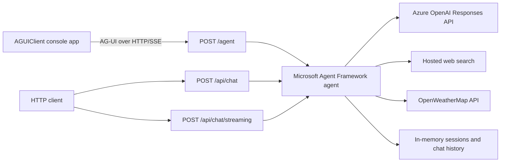

# AG-UI Sample

Sample application showing how to expose a Microsoft Agent Framework agent through REST, Server-Sent Events (SSE), and the AG-UI protocol, and how to consume it from a .NET console client.

## Features

- ASP.NET Core server targeting .NET 10.
- Azure OpenAI integration through the OpenAI Responses API.
- Microsoft Agent Framework agent with:
  - conversation history;
  - streaming responses;
  - hosted web search;
  - current weather and weather forecast tools;
  - a context provider that supplies the current UTC date and time.
- Three ways to interact with the agent:
  - synchronous REST endpoint;
  - streaming SSE endpoint;
  - AG-UI endpoint.
- Console client that consumes the AG-UI endpoint and streams responses.
- OpenAPI document and Swagger UI for the REST endpoints.

## Architecture



## Projects

| Project | Description |
|---|---|
| `AGUIServer` | ASP.NET Core server hosting the agent and exposing REST, SSE, and AG-UI endpoints. |
| `AGUIClient` | .NET console application that connects to `/agent` through `AGUI.Client`. |

The projects are intentionally stored in separate solution files:

- `AGUIServer.slnx`
- `AGUIClient.slnx`

## Prerequisites

- [.NET 10 SDK](https://dotnet.microsoft.com/download/dotnet/10.0)
- An Azure OpenAI resource with a deployed model that supports the Responses API
- An [OpenWeatherMap API key](https://openweathermap.org/api) to use the weather tools
- A trusted local ASP.NET Core HTTPS development certificate:

```powershell
dotnet dev-certs https --trust
```

## Configuration

The server loads `AGUIServer/appsettings.local.json` after `appsettings.json`. The local file is excluded from source control and is the recommended place for credentials.

Create `AGUIServer/appsettings.local.json` with the following content:

```json
{
  "AzureOpenAI": {
    "Endpoint": "https://your-resource-name.openai.azure.com/openai/v1/",
    "Deployment": "your-deployment-name",
    "ApiKey": "your-api-key"
  },
  "OpenWeatherMap": {
    "AppId": "your-openweathermap-api-key"
  }
}
```

| Setting | Description |
|---|---|
| `AzureOpenAI:Endpoint` | Azure OpenAI endpoint. It must include the `/openai/v1/` path. |
| `AzureOpenAI:Deployment` | Name of the deployed Azure OpenAI model. |
| `AzureOpenAI:ApiKey` | Azure OpenAI API key. |
| `OpenWeatherMap:AppId` | OpenWeatherMap API key used by the weather tools. |

Do not commit API keys. The weather key is only required when the agent invokes a weather tool.

## Build

Build the server and client solutions separately:

```powershell
dotnet build .\AGUIServer.slnx
dotnet build .\AGUIClient.slnx
```

Build output is written under the repository-level `artifacts` directory.

## Run

### 1. Start the server

```powershell
dotnet run --project .\AGUIServer\AGUIServer.csproj --launch-profile https
```

The HTTPS launch profile exposes:

- Server: `https://localhost:7017`
- Swagger UI: `https://localhost:7017/swagger`
- OpenAPI document: `https://localhost:7017/openapi/v1.json`

The server prints the raw requests sent to Azure OpenAI to the console for diagnostic purposes.

### 2. Start the client

In another terminal:

```powershell
dotnet run --project .\AGUIClient\AGUIClient.csproj
```

Enter a question at the `Question:` prompt. The client keeps a single agent session, assigns a thread ID to the conversation, and writes response updates as they arrive.

The client is configured for `https://localhost:7017/` in `AGUIClient/Program.cs`. Update its `HttpClient.BaseAddress` if the server runs on a different address.

## HTTP API

### Synchronous chat

`POST /api/chat`

Request:

```json
{
  "conversationId": null,
  "message": "What is the weather in Rome?"
}
```

Response:

```json
{
  "conversationId": "generated-or-supplied-conversation-id",
  "response": "The current weather in Rome is ...",
  "totalTokenCount": 123
}
```

Send the returned `conversationId` with subsequent requests to continue the same conversation.

### Streaming chat

`POST /api/chat/streaming`

The request body has the same shape as `/api/chat`. The response is an SSE stream containing:

| Event | Payload |
|---|---|
| `start` | The conversation ID. |
| `delta` | A partial response text update. |
| `metadata` | The total token count after completion. |

### AG-UI

`POST /agent`

This endpoint is mapped by `Microsoft.Agents.AI.Hosting.AGUI.AspNetCore` and is consumed by `AGUIChatClient` in the console client. It is excluded from the generated OpenAPI document.

## Agent behavior

The registered `Default` agent:

- uses concise and accurate assistant instructions;
- stores chat history in memory and retains up to 20 messages through `MessageCountingChatReducer`;
- injects the current UTC date and time before a run;
- can perform hosted web searches;
- can call OpenWeatherMap for current conditions and forecasts of 1 to 16 days.

Sessions and chat history are in memory. They are lost when the server restarts and are not suitable as-is for multi-instance or production deployments.

## License

This project is licensed under the [MIT License](LICENSE).
